# 実装と事例

**Hotakaについては、共通定義とアルゴリズムの設計案を掲載しています。**

このページでは、概念を具体的な形にした実装や事例を、公開したものから紹介していきます。
各実装が何を目的とし、概念のどの領域を担うのかを、対応する番号とともに示します。

## 概念との対応

| 領域 | 対応する番号 | 目的 |
| --- | --- | --- |
| Ⅰ 情報収集・蓄積 | 101〜103 | 先を考えるための材料を集め、蓄積する。 |
| Ⅱ 基礎分析 | 201〜204 | 基準時点と条件を明確にし、解釈や仮説の土台を作る。 |
| Ⅲ 発想・分析の指向とAIの活用 | 301〜305 | 材料と問いを結びつけ、先を考える。 |
| Ⅳ 可視化 | 401 | 結果を比較し、検討できる形で示す。 |
| Ⅴ ナレッジ化・ベクトル化 | 501〜504 | 検討結果を知識として蓄え、次の基礎分析に活かす。 |

公開する実装や事例には、目的・対応する番号・内容の説明・公開先へのリンクを添えます。

## Ⅱ Hotaka｜基礎分析

Hotakaは、EvaluationDateを基準に分析材料を選び、目的に対応するアルゴリズムを実装した各スロットが分析を実行し、結果を蓄積する基盤です。対象や項目の意味はINPUTで与え、共通の実行機構で処理します。

対象・項目・計算式・条件はテーマ側で定義します。Hotakaは、その定義とデータを受け取り、実行対象のスロットへINPUTを渡します。以下はX01の共通定義に基づく設計案です。

### 【図Ⅱ-1】基礎分析の構成

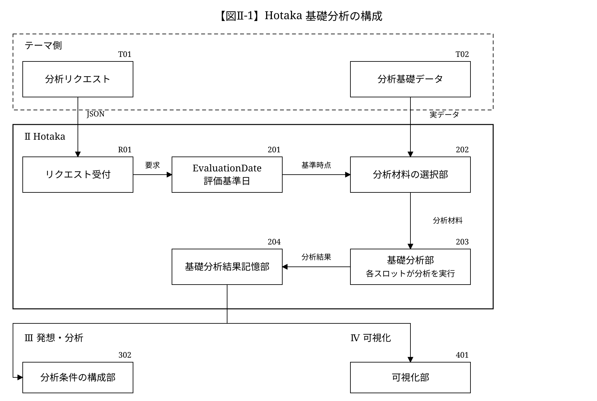

### 【表Ⅱ-1】構成要素と役割

| 記号 | 構成要素 | 役割・考え方 |
| --- | --- | --- |
| T01 | 分析リクエスト | テーマ側が、EvaluationDate・入力参照・項目の役割・分析目的・実行対象のスロット・設定をJSONで指定する。 |
| T02 | 分析基礎データ | テーマ側が用意した観測・集計データ。DB等に保持し、対象・時点・版を特定して渡す。 |
| R01 | リクエスト受付 | 要求単位にGUIDを発行する。入力・定義・モデルの版と実行状態を対応付ける。 |
| 201 | EvaluationDate | 人が指定する評価基準日。その時点に利用可能な情報の範囲を定める。 |
| 202 | 分析材料の選択部 | 入力参照を解決し、時点・対象・条件を確認する。各手法に必要な表・系列・比較集合等へ整える。 |
| 203 | 基礎分析部 | モデルの組合せを定義したアルゴリズムを、目的を持つ各スロットに実装する。実装された個々のスロットがINPUTを受け、分析を実行して結果を返す。 |
| 204 | 基礎分析結果記憶部 | GUID・実行したスロット・目的・入力テーマ・対象・評価日・アルゴリズム・ステップ・出力名に対応付けて結果を蓄積する。 |
| 302 | 分析条件の構成部 | Ⅱの基礎分析結果を、Ⅲの問い・背景・条件を構成する材料として利用する。 |
| 401 | 可視化部 | 保存した基礎分析結果とテーマの基礎データを、対象・条件・評価日を区別して表示する。 |

201〜204・302・401は全体の概念図と同じ番号です。T01・T02はテーマ側の入力、R01は本図で追加した受付の記号です。図中の名称を短くし、処理の内容は記号に対応する表へ記載しています。

### 【図Ⅱ-2】203 基礎分析部の内部構成

**各スロットは目的を持ちます。モデルの組合せを定義したアルゴリズム（ロジック）がスロットに実装され、実装された個々のスロットが分析を実行します。**

スロットは、この目的と実行のまとまりを表す概念です。分析モデルは個々の計算を担い、アルゴリズムはモデルをどう組み合わせるかを定義します。図では、スロットの枠内にアルゴリズムとモデルの組合せを置き、INPUTとOUTPUTをスロットへ接続しています。

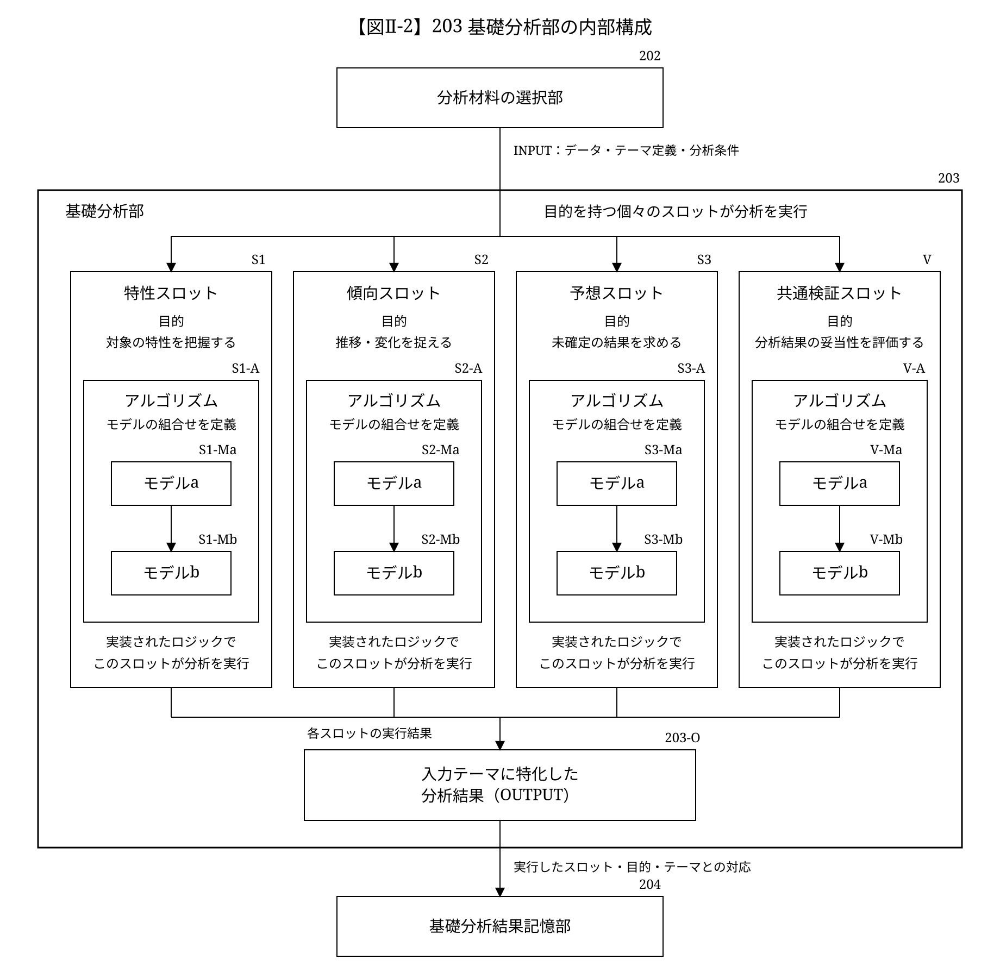

### 【表Ⅱ-2】203内部の構成要素と役割

| 記号 | 構成要素 | 役割・入出力 |
| --- | --- | --- |
| 202 | 分析材料の選択部 | 評価基準日までに利用可能なデータを選び、対象・項目の役割・型・単位・時間条件などの入力定義と共に、実行対象のスロットへ渡す。 |
| 203 | 基礎分析部 | 目的を持つ個々のスロットを備える。分析を実行する主体は、アルゴリズムのロジックを実装した各スロットである。 |
| S1 | 特性スロット | 対象の特性を把握することを目的とするスロット。その目的に対応するアルゴリズムを内部に実装し、INPUTを受けて分析を実行し、OUTPUTを返す。 |
| S1-A | S1内に実装するアルゴリズム | 使用するモデルと、その接続・順序などの組合せを定義したロジック。スロット内の実装内容を示す。 |
| S1-Ma | S1で使用するモデルa | 個々の推定・予測等を担う計算モデル。S1内に実装されたロジックに従って使われる。 |
| S1-Mb | S1で使用するモデルb | 個々の推定・予測等を担う計算モデル。S1内に実装されたロジックに従って使われる。 |
| S2 | 傾向スロット | 推移・変化を捉えることを目的とするスロット。その目的に対応するアルゴリズムを内部に実装し、INPUTを受けて分析を実行し、OUTPUTを返す。 |
| S2-A | S2内に実装するアルゴリズム | 使用するモデルと、その接続・順序などの組合せを定義したロジック。スロット内の実装内容を示す。 |
| S2-Ma | S2で使用するモデルa | 個々の推定・予測等を担う計算モデル。S2内に実装されたロジックに従って使われる。 |
| S2-Mb | S2で使用するモデルb | 個々の推定・予測等を担う計算モデル。S2内に実装されたロジックに従って使われる。 |
| S3 | 予想スロット | 未確定の結果を求めることを目的とするスロット。その目的に対応するアルゴリズムを内部に実装し、INPUTを受けて分析を実行し、OUTPUTを返す。 |
| S3-A | S3内に実装するアルゴリズム | 使用するモデルと、その接続・順序などの組合せを定義したロジック。スロット内の実装内容を示す。 |
| S3-Ma | S3で使用するモデルa | 個々の推定・予測等を担う計算モデル。S3内に実装されたロジックに従って使われる。 |
| S3-Mb | S3で使用するモデルb | 個々の推定・予測等を担う計算モデル。S3内に実装されたロジックに従って使われる。 |
| V | 共通検証スロット | 分析結果の妥当性を評価することを目的とするスロット。その目的に対応するアルゴリズムを内部に実装し、INPUTを受けて分析を実行し、OUTPUTを返す。 |
| V-A | V内に実装するアルゴリズム | 使用するモデルと、その接続・順序などの組合せを定義したロジック。スロット内の実装内容を示す。 |
| V-Ma | Vで使用するモデルa | 個々の推定・予測等を担う計算モデル。V内に実装されたロジックに従って使われる。 |
| V-Mb | Vで使用するモデルb | 個々の推定・予測等を担う計算モデル。V内に実装されたロジックに従って使われる。 |
| 203-O | 分析結果（OUTPUT） | 各スロットが実装されたアルゴリズムに従って返す結果。INPUTしたデータとテーマ定義に対応し、対象・指標・単位・条件・評価日との関係を保持する。 |
| 204 | 基礎分析結果記憶部 | 実行したスロット・目的・実行ID・入力テーマ・対象・評価日・アルゴリズムおよびモデルの版と共に結果を蓄積する。 |

S1・S2・S3・Vは、スロットの目的を4大分類で示したものです。各枠は、その目的に対応するロジックを実装するスロットの概念構造を表します。コードやモデルが開発済みであることを示す図ではありません。

枠の包含関係は「スロット内にアルゴリズムを実装し、その定義に従ってモデルを組み合わせる」関係を示します。矢印はデータ・結果の流れです。モデルa→bは接続の説明例であり、モデルの数・直列・並列・分岐などは個々のアルゴリズムの定義によります。必要なスロットを実行し、S1→S2→S3→Vという固定順序は設けません。

検証方法も、必要なモデルの組合せや評価手順としてアルゴリズムに定義します。その定義を実装したスロットが検証を実行します。共通検証を利用する場合は、検証を目的とするスロットVが実行を担います。

図中のS1-A・S1-Ma等は内部構造を説明する記号です。A01〜A24やM01〜M24の個別番号とは区別します。既存のM01〜M24には分析モデルに加え、モデル構造の指定・検証・再標本化などの手法や操作も含まれます。これらも、スロットに実装するロジックの構成要素として役割を区別します。

#### 分析結果と入力テーマの関係

**アルゴリズムのOUTPUTは、INPUTしたデータとテーマ定義に対応した、そのテーマに特化した分析結果となります。実行時には、そのアルゴリズムを実装したスロットが結果を返します。**

INPUTには観測値に加え、テーマの識別、対象、項目の意味・役割・単位、条件、評価基準日を含めます。各スロットは、実装されたロジックにこのINPUTを適用して、目的に対応する分析結果を得ます。

Hotakaは、共通の入出力契約・実行管理・返却型を保ちます。返却する表や分布の形式が共通でも、何を対象に何を表した結果かはINPUTされたテーマ定義に従います。204への蓄積と401での表示でも、実行したスロット・目的・テーマとの対応を保持します。

### 【表Ⅱ-3】スロットの役割

| 記号・スロット | 目的 | INPUT・OUTPUT |
| --- | --- | --- |
| S1 特性 | 指定条件・参照範囲で、対象がどのような性質を持つかを表す。水準、ばらつき、条件差、相性、類似性をまとめる。時間順の変化そのものはS2へ。 | INPUT：観測表・特徴量、対象と比較集団、条件。OUTPUT：評価表・条件差・分布要約・群分類。複数の返却型を許容する。 |
| S2 傾向 | 順序を持つ観測から、動き・持続・転換・前後差を表す。過去から評価日時点までの推移を調べる。 | INPUT：対象・順序キー・測定値の系列、窓や比較境界。OUTPUT：推移・差分・傾き・変化点・状態遷移。 |
| S3 予想 | 利用可能な情報から、まだ確定していない対象の値や結果を求める。S1・S2の出力や元の観測を必要に応じて参照する。 | INPUT：学習データまたは学習済みモデル、予測時点の入力・条件。OUTPUT：予測値、カテゴリ確率、順位・組合せ分布等。 |
| V 共通検証 | 分析結果の精度・安定性・適用範囲を評価する。検証ロジックを実装したスロットとして、他の分析から共通利用する。 | INPUT：対象分析の出力・モデル、比較基準や実結果、検証用データ。OUTPUT：誤差・校正・区間・診断。方法ごとに適用条件がある。 |

X01では、スロットの目的を特性・傾向・予想・検証の4大分類で整理します。各スロットに、その目的を実現するアルゴリズムのロジックを実装します。入力の対象や条件が異なっても、同じ目的と入出力契約に合えば、そのスロットを利用できます。必要な分析が具体化した段階でスロットを追加します。

Ⅱの予想は、定義した統計・機械学習モデルによる計算です。その結果を材料に問いや仮説を検討する工程が、Ⅲの発想・分析に当たります。

### INPUTで具体化する共通定義

INPUTから受け取る対象・変数・条件を、各手法に必要な役割へ対応付けます。表示名や業務上の意味はテーマ定義に保持し、共通本体には特定の対象名・集計式・参照期間を固定しません。

| 定義要素 | 共通で扱う内容 | INPUTと内部処理の対応 |
| --- | --- | --- |
| 分析目的・名称 | 各スロットが持つ分析目的と、入力テーマの対象・表示名を対応付ける。 | テーマの識別、対象、表示名、評価指標の意味を受け取り、スロットの目的・OUTPUT・結果表示へ対応付ける。 |
| モデル・手法・操作 | アルゴリズムに、使用するモデル・手法・操作とその組合せを定義する。 | 各スロットが、実装されたロジックに従って学習・予測・変換・集約・検証等を実行する。 |
| 観測単位・対象ID | 一行が何を表すか、対象を何で識別するかを定義する。 | 観測イベント、対象と評価日、関連対象の有効期間等の粒度を指定する。単位の名称は入力側で定義する。 |
| 説明変数・目的変数 | 列の名前とは別に、数値・カテゴリ・順位等の役割と型を指定する。 | 評価指標をy、説明に用いる属性・条件をXへ対応付ける。変数の型・尺度・単位も受け取る。 |
| 投入ブロック | M01が必要とする、変数群と投入順を表す。 | 統制する条件、注目する変数群、交互作用項などを、指定したブロック順に追加する。 |
| グループ構造 | M02等が必要とする、グループキーと入れ子・交差、対象別に変える項を指定する。 | 対象・関連対象・条件群を識別するキーと有効期間、入れ子／交差の関係を指定する。 |
| 分布・推定方式 | モデルの分布、リンク関数、最尤・ベイズ等の方式と方式別設定を受け取る。 | 事前分布・尤度・推定設定を入力定義から受け取る。共通本体が特定分野の事前知識を固定しない。 |
| 式・変換・組合せ | 対応する演算、交互作用、正規化等を定義から実行する。 | 対象属性と条件の交互作用、変換式、合成係数等を指定し、対応する演算で処理する。 |
| 入力参照・依存関係 | 元データと、他の分析の出力の参照を受け取り、必要な順に実行する。 | 入力データの参照、集計済み指標、保存済みの分析結果を、入力契約に対応付けて渡す。 |
| 評価日・時間条件 | 評価日・情報の利用可能時点・参照期間を管理する。期間を全テーマ共通の固定値にしない。 | 評価日、参照期間、境界の含め方、情報の利用可能時点を受け取る。参照年数を共通の固定値にしない。 |
| 学習と検証 | 観測時点・グループ単位を保った分割と評価指標を指定する。 | 同一イベントや対象内の依存を保って分割する。予測時点で未知の結果は検証側へ分離する。 |
| 手法別の返却形式 | 係数表、予測表、分布、遷移行列等を手法ごとの出力契約で返す。 | 対象別の推定値、測定値の分位点、比較集合の順位分布等を、INPUTしたテーマの分析結果として返す。対象数・指標の意味・単位は入力定義から決まる。 |
| 共通の蓄積情報 | 実行ID、評価日、定義・モデル版、入力参照、対象ID、結果への参照と状態を保持する案。 | 評価日ごとの結果を、入力・分析定義・モデルの版に対応付けて蓄積する。物理的な保存構造は未定。 |
| 表示・解釈 | 表示名・単位・対象との対応はテーマ定義が持つ。結果の型に応じた共通表示を用意する。 | 出力値の表示名・単位・解釈を入力定義に対応付ける。統計的関連と因果効果は区別する。 |
| 手法の追加 | 共通実行管理と手法別の入出力契約を分け、必要な実行部を追加する。 | 同じ共通I/Fから新しい手法を利用する。追加する演算には対応する実行部が必要。 |

カテゴリサブ名称と使用する分析手法

| サブ名称 | 対応する分析内容 | 手法の例 |
| --- | --- | --- |
| 特性A｜水準 | 対象の水準、関連対象A・Bの寄与、比較集合全体の水準。対象と集約単位は入力定義で指定する。 | M02 マルチレベル回帰、M10 順位モデル、M21 分布集約。 |
| 特性B｜分布・ばらつき | 測定値の分布、選択カテゴリの分布、評価指標の安定性、事象の発生傾向、比較集合の拮抗・突出。 | M06 分布分析、M07 分位点回帰、M08 ロジスティック回帰等。 |
| 特性C｜条件・組合せ | 環境・条件への適合、比較集団の水準との関係、設定値の適合、対象間の相性、事前測定値と結果の関連。 | M04＋M05 交互作用、M02 グループ差、M13 GAM、M12 勾配ブースティング等。 |
| 特性D｜類似・分類 | 複数の特性に基づく対象の類似性・群分類。 | M18 主成分分析、M19 クラスタリング。 |
| 傾向A｜推移・変動 | 対象状態の基調の変化、直近n観測の評価指標の変動。潜在状態の推定と観測値の動きを区別する。 | M14 状態空間／M15 変化点、M06 差分・窓内分布、任意でM16 遷移。 |
| 傾向B｜持続・転換 | 対象や関連対象の状態の持続、有効期間内や組合せ変更後の状態の継続・転換。 | M14 状態空間、M15 変化点、履歴を使うM04 回帰。 |
| 傾向C｜前後比較 | 指定した出来事・設定変更・調整の前後で、条件を考慮して比較する評価指標の差。 | M17 条件調整前後比較・分割時系列回帰。 |
| 予想A｜数値 | 予測対象ごとの期待値・比較値。利用可能な複数の入力を組み合わせ、未確定の値を推定する。 | M04 回帰、M12 勾配ブースティング等。 |
| 予想B｜順位・組合せ | 比較集合内の順位・組合せの予測。対象数・順位の意味・組合せ制約は入力定義から受け取る。 | M10 順位モデル、整合した確率モデルを使うM20 モンテカルロ法。 |
| 検証A｜精度・信頼度 | 分析結果の精度・信頼度・適用範囲。対象の出力型に合った検証を必要に応じて組み合わせる。 | M22 時系列検証、M23 確率校正、M24 再標本化。適用できる出力型を確認する。 |

サブ名称は目的を整理するための分類です。目的に必要なモデルの組合せをアルゴリズムとして定義し、そのロジックをスロットに実装します。組み合わせるモデルの適合性は、型・観測単位・尺度・時間条件を含む入出力契約で確認します。

### 【表Ⅱ-4】INPUTと結果の対応

| 内容 | 形式・受渡し | 扱い |
| --- | --- | --- |
| 分析リクエスト | JSON | 評価日・入力参照・項目の役割・分析目的・実行対象のスロット・設定を渡す。 |
| 観測・集計データ | DB等のデータを参照 | 大量のデータは供給部で取得し、各手法に合う表・系列・比較集合等へ整える。 |
| 学習済みモデル | 版を特定したモデル参照 | 予測や変換に用いる係数・学習状態等を取得する。 |
| 分析結果 | 蓄積した結果とその参照 | GUID・実行したスロット・アルゴリズム・ステップ・出力名で識別し、結果表には対象・評価日等を持たせる。 |

同じ要求から複数の結果を返せる構成とします。入力・分析定義・モデルの版を結果と対応付け、同じ評価日でも条件の違う分析を区別します。

### 【表Ⅱ-5】共通定義によるアルゴリズムの構成例

No.01〜No.24の構成を共通定義の表現で示し、A01〜A24と表記します。これらは、目的を持つスロットへ実装するモデルの組合せ（ロジック）の例です。具体的なスロット構成は、分析目的に応じて定めます。M01〜M24は再利用する分析手法・操作の記号です。各アルゴリズム内の箱には、A02-01のように処理を識別する記号を付けています。

| No.／算法 | 分類 | 構成例 | 手法 | INPUT | OUTPUT |
| --- | --- | --- | --- | --- | --- |
| 01／A01 | 特性A｜水準 | 対象の水準 | M02・M10 | 観測値、対象・関連対象・条件群、比較集合 | 条件を考慮した相対評価、推定幅 |
| 02／A02 | 特性C｜条件・組合せ | 条件群との適合 | M05・M02 | 観測値、対象、条件群、調整変数、比較基準 | 条件群ごとの推定差、観測数、推定幅 |
| 03／A03 | 特性C｜条件・組合せ | 配置条件との適合 | M05・M10 | 比較集合、観測順位、対象、配置条件、属性 | 配置条件別の順位確率と差 |
| 04／A04 | 特性B｜分布・ばらつき | 測定値の分布特性 | M02・M07・M06 | 数値観測、対象、条件群、グループ構造 | 平均構造、分位点、観測分布 |
| 05／A05 | 特性B｜分布・ばらつき | カテゴリの分布 | M08・M11 | カテゴリの観測、説明変数、クラス定義 | 条件別のカテゴリ確率、分類規則 |
| 06／A06 | 特性B｜分布・ばらつき | 評価指標の安定性 | M06・M07 | 事前の期待値、対応する実績値、条件 | 残差分布、上下の幅、観測数 |
| 07／A07 | 傾向A｜推移・変動 | 状態の推移・変化 | M14・M15 | 対象、時刻、観測値、条件 | 状態推移、変化量、変化点、推定幅 |
| 08／A08 | 特性C｜条件・組合せ | 比較集団の水準との関係 | M05・M04 | 実績値、事前の集団水準、対象、条件 | 集団水準別の推定値と差 |
| 09／A09 | 傾向A｜推移・変動 | 直近n観測の指標変動 | M06・M16 | 対象、観測ID・順序、時刻、条件群、指標値、n | 系列、前回差、窓内分布、必要なら遷移 |
| 10／A10 | 特性B｜分布・ばらつき | 指定事象の発生傾向 | M02・M03・M08 | 事象ラベル、観測母数、対象、条件 | 事象確率、条件差、推定幅 |
| 11／A11 | 特性A｜水準 | 関連対象の寄与 | M02・M10 | 実績値、対象と関連対象の対応、有効期間、条件 | 関連対象別の相対寄与、推定幅 |
| 12／A12 | 傾向B｜持続・転換 | 状態の持続・転換 | M14・M15 | 有効期間内の観測系列、関連付けの変更履歴 | 持続する状態、転換時点、推定幅 |
| 13／A13 | 特性A｜水準 | 複数対象の寄与分離 | M02 | 対象・関連対象の対応、実績値、条件、グループ構造 | 対象別の寄与、観測数、推定幅 |
| 14／A14 | 特性C｜条件・組合せ | 設定値との関係 | M13・M05・M04 | 設定値、実績値、対象・関連対象、条件 | 関係曲線、条件差、推定幅 |
| 15／A15 | 傾向C｜前後比較 | 変更前後の比較 | M17 | 変更時点、前後の観測値、時間、調整変数 | 前後差、水準・傾きの差、推定幅 |
| 16／A16 | 特性C｜条件・組合せ | 対象間の相性 | M05・M02 | 対象間の組合せ、実績値、条件 | 個別効果を考慮した組合せの差 |
| 17／A17 | 特性C｜条件・組合せ | 環境条件との関係 | M13・M12 | 環境を表す変数、対象、実績値、調整変数 | 条件別の関係曲線、推定値の差 |
| 18／A18 | 特性C｜条件・組合せ | 事前指標と実績値の関係 | M04・M12・M06 | 事前指標、利用可能時点、対応する実績値、条件 | 指標からの期待値、実績との差の分布 |
| 19／A19 | 特性D｜類似・分類 | 類似性・群分類 | M18・M19 | 同じ定義・期間の数値特徴量表 | 群ID、群の特徴、類似度 |
| 20／A20 | 予想A｜成績値 | 対象単位の数値予測 | M04・M12 | 事前情報・評価値、学習データまたはモデル参照 | 予測値、比較値、入力・モデル参照 |
| 21／A21 | 特性A｜水準 | 比較集合の水準 | M21 | 構成員、比較可能な評価値、集約式・重み・境界 | 集合の集約値、区分、根拠指標 |
| 22／A22 | 特性B｜分布・ばらつき | 比較集合の拮抗・突出 | M06・M21 | 構成員の評価値、必要に応じて予測分布 | 評価差・分散、分布の集中度 |
| 23／A23 | 予想B｜順位・組合せ | 順位・組合せの予測 | M10・M20 | 学習済み順位モデルまたは学習データ、対象集合、条件 | 順位別・組合せ別の確率、計算誤差 |
| 24／A24 | 検証A｜精度・信頼度 | 精度・信頼度・適用範囲 | M22・M23・M24 | 分析定義、時系列データ、実績値、分割・評価設定 | 誤差、校正、区間、条件別の診断 |

分類は各スロットの目的に対応します。同じモデルを用いても、対象の性質を把握するスロットと、未確定の結果を求めるスロットでは、目的と実装するロジックが異なります。

### アルゴリズムの構成

以下の図は、各スロットに実装するアルゴリズムのロジックを示します。実行するのは、そのロジックを実装したスロットです。各図の直下に、すべての箱の記号と説明を記載します。実線はデータ・結果の受渡し、破線の矢印はモデルへ組み込む構造の指定を表します。代替経路や任意の処理は矢印の注記で区別します。

A01 対象の水準

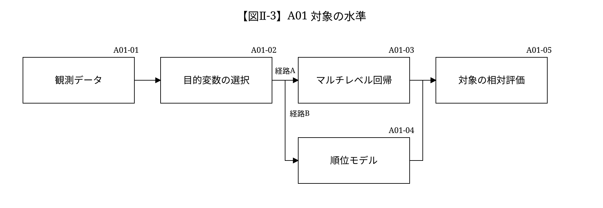

**【表Ⅱ-6】A01 構成要素と役割**

| 記号 | 構成要素 | 手法 | 役割・入出力 |
| --- | --- | --- | --- |
| A01-01 | 観測データ | — | 観測値、対象・関連対象・条件群のキーを受け取る。 |
| A01-02 | 目的変数の選択 | — | 数値の目的変数か、比較集合内の順位かを定義に従って選ぶ。 |
| A01-03 | マルチレベル回帰 | M02 | 対象や関連対象のグループ差を含めて数値の目的変数を推定する。 |
| A01-04 | 順位モデル | M10 | 比較集合・観測順位・特徴量から相対的な評価を推定する。 |
| A01-05 | 対象の相対評価 | — | モデルの尺度に従い、対象別・条件別の評価と推定幅を返す。 |

目的変数の型に応じて数値モデルまたは順位モデルを選びます。異なるモデルの評価尺度を同一視せず、比較の基準と共に返します。

A02 条件群との適合

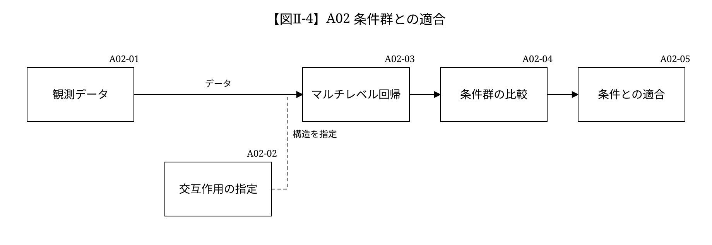

**【表Ⅱ-7】A02 構成要素と役割**

| 記号 | 構成要素 | 手法 | 役割・入出力 |
| --- | --- | --- | --- |
| A02-01 | 観測データ | — | 観測値、対象・条件群のキー、調整変数と利用可能時点を受け取る。 |
| A02-02 | 交互作用の指定 | M05 | 対象と条件群の交互作用をモデル構造として指定する。 |
| A02-03 | マルチレベル回帰 | M02 | 観測データと構造の指定から、共通傾向・対象差・交互作用を一体として推定する。 |
| A02-04 | 条件群の比較 | — | 指定した基準条件を揃え、条件群ごとの推定値と基準との差を求める。 |
| A02-05 | 条件との適合 | — | 条件群ごとの差、観測数、推定幅を対象・評価日・実行IDに対応付けて返す。 |

M05で指定した交互作用をM02の構造に組み込み、一体として推定します。M05の出力はモデル構造であり、独立した予測値ではありません。

A03 配置条件との適合

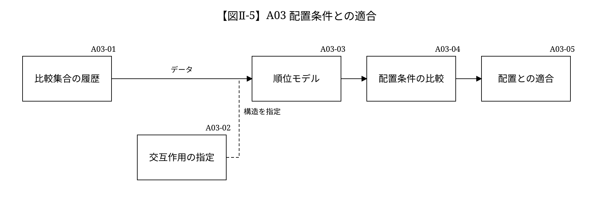

**【表Ⅱ-8】A03 構成要素と役割**

| 記号 | 構成要素 | 手法 | 役割・入出力 |
| --- | --- | --- | --- |
| A03-01 | 比較集合の履歴 | — | 比較集合、観測順位、対象、配置条件と関連する属性を受け取る。 |
| A03-02 | 交互作用の指定 | M05 | 対象と配置条件の交互作用をモデル構造に含める。 |
| A03-03 | 順位モデル | M10 | 指定された構造を含む順位モデルを学習する。 |
| A03-04 | 配置条件の比較 | — | 他の条件を揃え、配置条件ごとの順位確率を比較する。 |
| A03-05 | 配置との適合 | — | 配置条件に応じた確率と差を返す。 |

配置の意味・種類は入力定義が与えます。交互作用を含む順位モデルを用い、同じ基準条件で比較します。

A04 測定値の分布特性

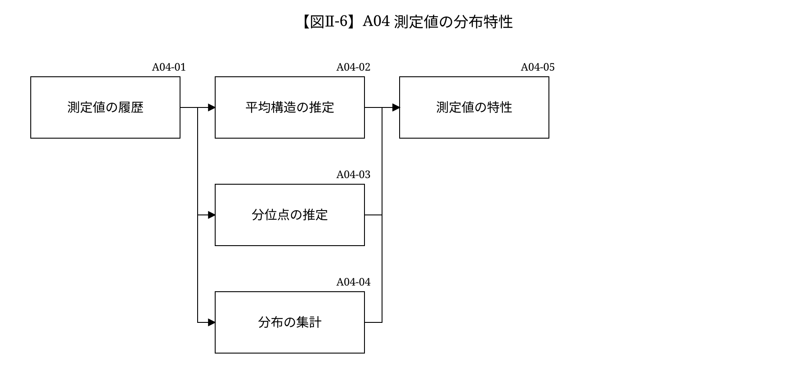

**【表Ⅱ-9】A04 構成要素と役割**

| 記号 | 構成要素 | 手法 | 役割・入出力 |
| --- | --- | --- | --- |
| A04-01 | 測定値の履歴 | — | 測定値、対象・条件群、観測時点と有効な観測の範囲を受け取る。 |
| A04-02 | 平均構造の推定 | M02 | 対象や条件の違いを考慮し、測定値の平均構造を推定する。 |
| A04-03 | 分位点の推定 | M07 | 指定された条件付き分位点を推定する。 |
| A04-04 | 分布の集計 | M06 | 観測された測定値の分布、ばらつき、件数を集計する。 |
| A04-05 | 測定値の特性 | — | 平均構造・分位点・観測分布を、型と意味を区別して返す。 |

平均構造、条件付き分位点、観測値の分布は異なる情報です。出力名と型を分け、必要な結果を参照します。

A05 カテゴリの分布

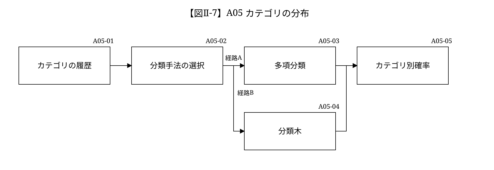

**【表Ⅱ-10】A05 構成要素と役割**

| 記号 | 構成要素 | 手法 | 役割・入出力 |
| --- | --- | --- | --- |
| A05-01 | カテゴリの履歴 | — | 観測カテゴリと、その時点に利用可能な説明変数を受け取る。 |
| A05-02 | 分類手法の選択 | — | 多項分類または分類木を定義に従って選ぶ。 |
| A05-03 | 多項分類 | M08 | カテゴリを目的変数とし、クラス別の確率を学習する。 |
| A05-04 | 分類木 | M11 | 入力条件による分岐規則とカテゴリの分布を学習する。 |
| A05-05 | カテゴリ別確率 | — | 指定条件におけるカテゴリ確率と分類規則を返す。 |

対象の性質を表す実行はS1、未確定の観測のカテゴリを予測する実行はS3とします。複数対象間の割当制約は別途定義が必要です。

A06 評価指標の安定性

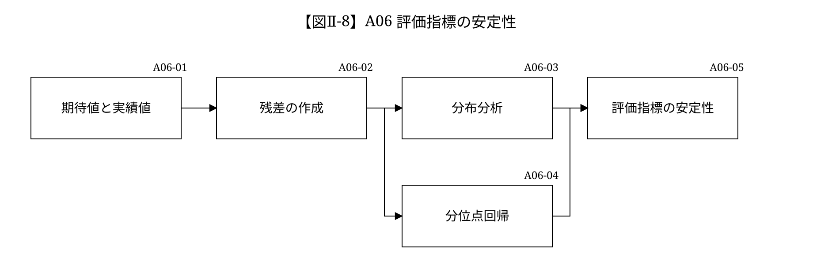

**【表Ⅱ-11】A06 構成要素と役割**

| 記号 | 構成要素 | 手法 | 役割・入出力 |
| --- | --- | --- | --- |
| A06-01 | 期待値と実績値 | — | 事前に求めた期待値と対応する実績値、観測条件を受け取る。 |
| A06-02 | 残差の作成 | — | 実績値から期待値を引き、観測ごとの残差を作る。 |
| A06-03 | 分布分析 | M06 | 残差の分布、ばらつき、上下の裾を集計する。 |
| A06-04 | 分位点回帰 | M07 | 残差の条件付き分位点を推定する。 |
| A06-05 | 評価指標の安定性 | — | 安定性、上下への幅、使用した観測数を返す。 |

各時点の事前予測または時間分割した予測から残差を作ります。学習に用いた観測への当てはまりと、未使用期間の予測誤差を区別します。

A07 状態の推移・変化

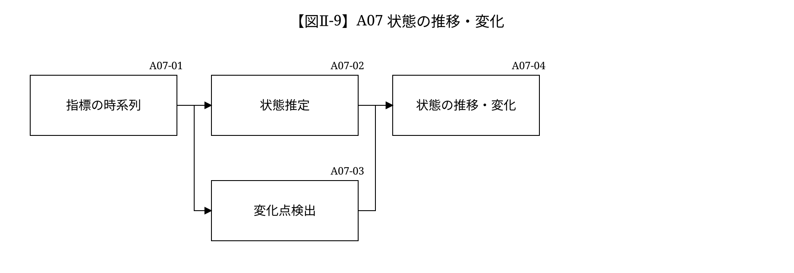

**【表Ⅱ-12】A07 構成要素と役割**

| 記号 | 構成要素 | 手法 | 役割・入出力 |
| --- | --- | --- | --- |
| A07-01 | 指標の時系列 | — | 対象、時刻、観測間隔を伴う指標系列を受け取る。 |
| A07-02 | 状態推定 | M14 | 評価日までの観測から基調となる状態と推移を推定する。 |
| A07-03 | 変化点検出 | M15 | 入力定義が指定する性質の変化点を検出する。 |
| A07-04 | 状態の推移・変化 | — | 推定状態、変化量、変化点と推定幅を返す。 |

評価日までの情報で計算します。過去時点を再現する場合、その後の観測を用いた状態推定や変化点情報を混入させません。

A08 比較集団の水準との関係

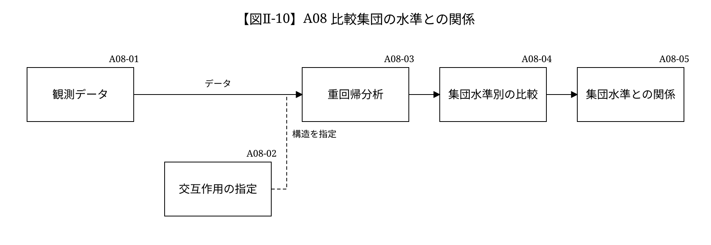

**【表Ⅱ-13】A08 構成要素と役割**

| 記号 | 構成要素 | 手法 | 役割・入出力 |
| --- | --- | --- | --- |
| A08-01 | 観測データ | — | 実績値、事前に求めた比較集団の水準、対象と条件を受け取る。 |
| A08-02 | 交互作用の指定 | M05 | 対象と比較集団の水準の交互作用を指定する。 |
| A08-03 | 重回帰分析 | M04 | 指定した交互作用を含む重回帰モデルを学習する。 |
| A08-04 | 集団水準別の比較 | — | 比較集団の水準を変え、同じ基準条件で推定値を比較する。 |
| A08-05 | 集団水準との関係 | — | 水準に応じた推定値の違いと推定幅を返す。 |

集団水準は該当する観測より前に利用可能な情報から与えます。説明対象の実績値を使って事前の説明変数を作らないよう、利用可能時点を確認します。

A09 直近n観測の指標変動

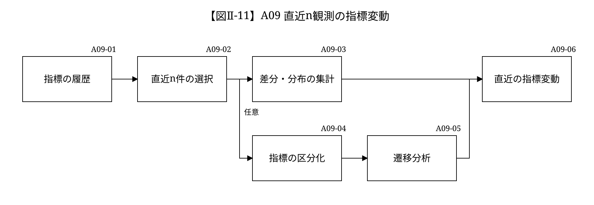

**【表Ⅱ-14】A09 構成要素と役割**

| 記号 | 構成要素 | 手法 | 役割・入出力 |
| --- | --- | --- | --- |
| A09-01 | 指標の履歴 | — | 対象ID、観測ID、時刻、順序キー、条件群、指標値を受け取る。 |
| A09-02 | 直近n件の選択 | — | 対象条件を絞り、基準時点までの最新n件を選んで古い順に並べる。 |
| A09-03 | 差分・分布の集計 | M06 | 前回差、窓内の平均・分散等を設定に従って集計する。 |
| A09-04 | 指標の区分化 | — | 遷移を調べる場合、入力された境界で指標を区分する。 |
| A09-05 | 遷移分析 | M16 | 隣接する観測の状態遷移を集計する。n観測の隣接ペアは最大n−1件。 |
| A09-06 | 直近の指標変動 | — | 指標系列、差分・分布、実件数、参照範囲を返す。 |

対象・条件を先に絞り、最新n件を選んで古い順に並べます。nは観測件数です。実件数と参照範囲を返し、区分化する場合は入力された境界を使います。

A10 指定事象の発生傾向

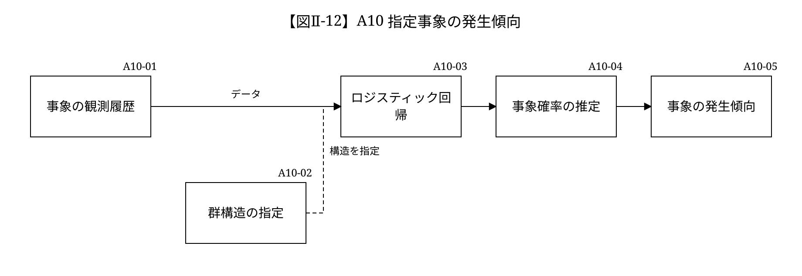

**【表Ⅱ-15】A10 構成要素と役割**

| 記号 | 構成要素 | 手法 | 役割・入出力 |
| --- | --- | --- | --- |
| A10-01 | 事象の観測履歴 | — | 指定事象のラベル、観測母数、対象、説明変数を受け取る。 |
| A10-02 | 群構造の指定 | M02・M03 | グループ構造を指定する。階層ベイズを推定方式として選ぶこともできる。 |
| A10-03 | ロジスティック回帰 | M08 | 群差を含むロジスティックモデルを一体として学習する。 |
| A10-04 | 事象確率の推定 | — | 同じ基準条件で事象のクラス別確率を求める。 |
| A10-05 | 事象の発生傾向 | — | 事象確率、条件差、観測数と推定幅を返す。 |

M02の群構造、M03の推定方式、M08の確率モデルを組み合わせる構成例です。必要な構造に対応する実行部を選び、通常の線形回帰へ二値ラベルを渡すだけの処理にはしません。

A11 関連対象の寄与

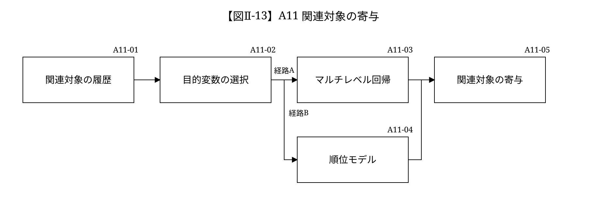

**【表Ⅱ-16】A11 構成要素と役割**

| 記号 | 構成要素 | 手法 | 役割・入出力 |
| --- | --- | --- | --- |
| A11-01 | 関連対象の履歴 | — | 対象と関連対象の対応、有効期間、実績値、条件を受け取る。 |
| A11-02 | 目的変数の選択 | — | 数値の目的変数または順位を扱うモデルを選ぶ。 |
| A11-03 | マルチレベル回帰 | M02 | 対象と条件を考慮して、関連対象の寄与を推定する。 |
| A11-04 | 順位モデル | M10 | 関連対象のグループ構造を含む順位モデルを学習する。 |
| A11-05 | 関連対象の寄与 | — | 関連対象の同一性・有効期間を区別して相対寄与と推定幅を返す。 |

対象の同一性と有効期間を入力キーで区別します。寄与の分離が可能かは、対象と関連対象の組合せの観測状況にも依存します。

A12 状態の持続・転換

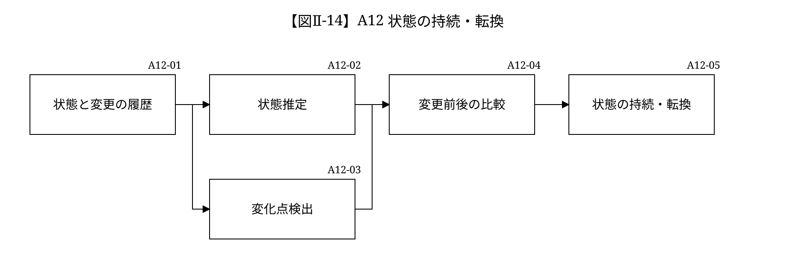

**【表Ⅱ-17】A12 構成要素と役割**

| 記号 | 構成要素 | 手法 | 役割・入出力 |
| --- | --- | --- | --- |
| A12-01 | 状態と変更の履歴 | — | 同一性が保たれる期間の観測系列と、関連付けの変更履歴を受け取る。 |
| A12-02 | 状態推定 | M14 | 履歴から対象の状態と推移を推定する。 |
| A12-03 | 変化点検出 | M15 | 状態や指標の変化点を検出する。 |
| A12-04 | 変更前後の比較 | — | 推定状態を関連付けの変更前後で対応付ける。 |
| A12-05 | 状態の持続・転換 | — | 持続する状態、転換時点、推定幅を返す。 |

対象の同一性の境界と、関連付けの変更を区別します。変更前後の関連を比較する構成であり、変更の因果効果を自動的に認定するものではありません。

A13 複数対象の寄与分離

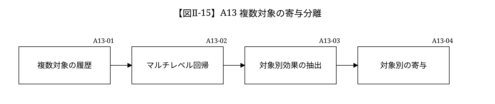

**【表Ⅱ-18】A13 構成要素と役割**

| 記号 | 構成要素 | 手法 | 役割・入出力 |
| --- | --- | --- | --- |
| A13-01 | 複数対象の履歴 | — | 対象・関連対象の対応、観測値、条件、有効期間を受け取る。 |
| A13-02 | マルチレベル回帰 | M02 | 入力されたグループ構造に従い、各対象の効果を推定する。 |
| A13-03 | 対象別効果の抽出 | — | 同じ基準条件で対象別の効果を抽出する。 |
| A13-04 | 対象別の寄与 | — | 対象別の相対寄与、観測数、推定幅を返す。 |

対象の種別数や識別キーは入力定義から受け取ります。組合せが固定されるなど寄与を分離できない場合は、その状態を結果に付記します。

A14 設定値との関係

**【表Ⅱ-19】A14 構成要素と役割**

| 記号 | 構成要素 | 手法 | 役割・入出力 |
| --- | --- | --- | --- |
| A14-01 | 設定値と実績値 | — | 設定値、実績値、対象・関連対象と条件を受け取る。 |
| A14-02 | 関係表現の選択 | — | 滑らかな関係または交互作用回帰を選ぶ。 |
| A14-03 | 一般化加法モデル | M13 | 設定値と実績値の非線形な関係を推定する。 |
| A14-04 | 交互作用回帰 | M05・M04 | 対象や条件との交互作用を含めた回帰を学習する。 |
| A14-05 | 設定値との関係 | — | 観測範囲内の関係曲線、条件差、推定幅を返す。 |

観測範囲と設定値の選ばれ方を考慮して解釈します。観測上の関連を、設定変更の因果効果と同一視しません。

A15 変更前後の比較

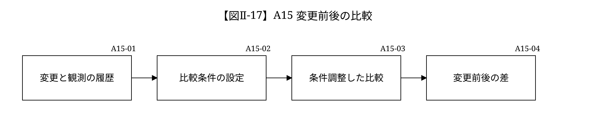

**【表Ⅱ-20】A15 構成要素と役割**

| 記号 | 構成要素 | 手法 | 役割・入出力 |
| --- | --- | --- | --- |
| A15-01 | 変更と観測の履歴 | — | 変更イベントの時点と種別、前後の観測値と条件を受け取る。 |
| A15-02 | 比較条件の設定 | — | 比較窓・対象・調整条件を設定する。 |
| A15-03 | 条件調整した比較 | M17 | 条件を考慮した前後差、水準・傾きの変化を推定する。 |
| A15-04 | 変更前後の差 | — | 前後差、対象期間、観測数、推定幅を返す。 |

比較窓・境界・調整条件を入力定義で指定します。同時期の他の変化も考慮し、観測上の前後差と因果効果を区別します。

A16 対象間の相性

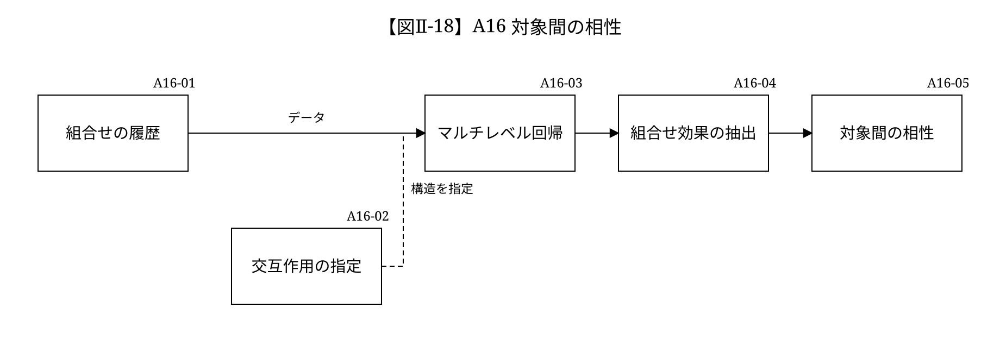

**【表Ⅱ-21】A16 構成要素と役割**

| 記号 | 構成要素 | 手法 | 役割・入出力 |
| --- | --- | --- | --- |
| A16-01 | 組合せの履歴 | — | 対象間の組合せ、実績値、条件を受け取る。 |
| A16-02 | 交互作用の指定 | M05 | 対象間の交互作用をモデル構造として指定する。 |
| A16-03 | マルチレベル回帰 | M02 | 個別効果と組合せ効果を同じモデルで推定する。 |
| A16-04 | 組合せ効果の抽出 | — | 個別の共通効果を考慮したうえで、組合せによる差を抽出する。 |
| A16-05 | 対象間の相性 | — | 相性の推定値、組合せの観測数、推定幅を返す。 |

個別効果と組合せ効果を同じモデル構造で推定します。共通効果の二重加算を避け、組合せごとの観測数と推定幅を返します。

A17 環境条件との関係

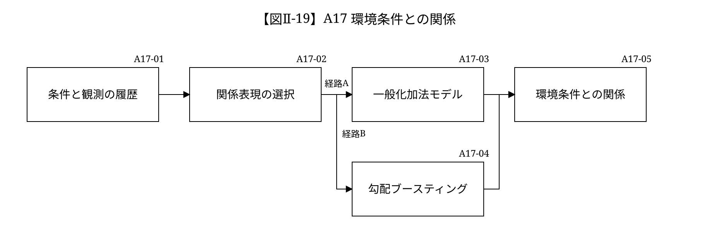

**【表Ⅱ-22】A17 構成要素と役割**

| 記号 | 構成要素 | 手法 | 役割・入出力 |
| --- | --- | --- | --- |
| A17-01 | 条件と観測の履歴 | — | 環境を表す変数、対象、観測値と調整変数を受け取る。 |
| A17-02 | 関係表現の選択 | — | 関係を表現する手法を分析定義から選ぶ。 |
| A17-03 | 一般化加法モデル | M13 | 連続条件と目的変数の滑らかな関係を推定する。 |
| A17-04 | 勾配ブースティング | M12 | 非線形な関係や交互作用を含むモデルを学習する。 |
| A17-05 | 環境条件との関係 | — | 指定した環境条件ごとの関係曲線や推定値の差を返す。 |

変数の意味と単位は入力定義が与えます。予測時はその時点で利用可能な条件を用い、未観測範囲への適用を区別します。

A18 事前指標と実績値の関係

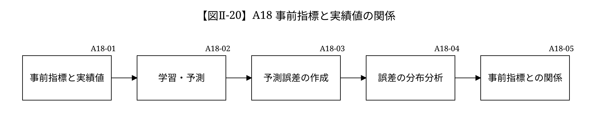

**【表Ⅱ-23】A18 構成要素と役割**

| 記号 | 構成要素 | 手法 | 役割・入出力 |
| --- | --- | --- | --- |
| A18-01 | 事前指標と実績値 | — | 事前指標、条件、利用可能時点と、その後の実績値を対応付ける。 |
| A18-02 | 学習・予測 | M04・M12 | 重回帰または勾配ブースティングで実績値を説明・予測する。 |
| A18-03 | 予測誤差の作成 | — | 学習に使わなかった後続期間で予測と実績の差を求める。 |
| A18-04 | 誤差の分布分析 | M06 | 予測誤差の分布を要約する。 |
| A18-05 | 事前指標との関係 | — | 事前指標から求めた期待値と、実績との差の傾向を返す。 |

関連を見る実行は特性C、未確定の値を求める実行は予想Aとします。予測誤差は未使用期間で評価し、学習時の残差と区別します。

A19 類似性・群分類

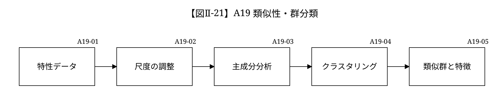

**【表Ⅱ-24】A19 構成要素と役割**

| 記号 | 構成要素 | 手法 | 役割・入出力 |
| --- | --- | --- | --- |
| A19-01 | 特性データ | — | 定義・期間を揃えた対象ごとの数値特徴量を受け取る。 |
| A19-02 | 尺度の調整 | — | 学習対象から尺度の変換を求め、変換設定を保存する。 |
| A19-03 | 主成分分析 | M18 | 複数の特性を主成分へ変換する。 |
| A19-04 | クラスタリング | M19 | 指定した距離や方法で類似した対象を分類する。 |
| A19-05 | 類似群と特徴 | — | 群ID、群の特徴、類似対象と距離を返す。 |

主成分分析を前段に置く構成例です。変換を学習対象から求めて保存し、新しい対象へ同じ変換を適用します。群IDに優劣は付与しません。

A20 対象単位の数値予測

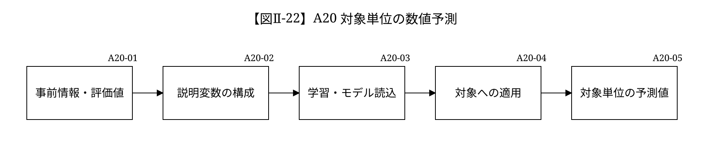

**【表Ⅱ-25】A20 構成要素と役割**

| 記号 | 構成要素 | 手法 | 役割・入出力 |
| --- | --- | --- | --- |
| A20-01 | 事前情報・評価値 | — | 予測時点に利用可能な観測、各種評価と条件を受け取る。 |
| A20-02 | 説明変数の構成 | — | 対象・時点・定義版を揃え、説明変数の表を構成する。 |
| A20-03 | 学習・モデル読込 | M04・M12 | 過去の事前情報で学習するか、保存したモデルを読み込む。 |
| A20-04 | 対象への適用 | — | 学習済みモデルを予測対象へ適用する。 |
| A20-05 | 対象単位の予測値 | — | 対象別の予測値と、入力・モデルの参照を返す。 |

学習用の過去の特徴量も、その予測時点で利用可能だった値を使います。複数対象の整合した順位分布が必要な場合はA23のような構成を選びます。

A21 比較集合の水準

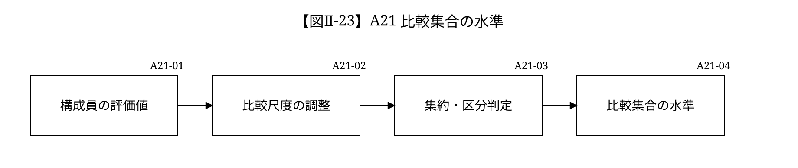

**【表Ⅱ-26】A21 構成要素と役割**

| 記号 | 構成要素 | 手法 | 役割・入出力 |
| --- | --- | --- | --- |
| A21-01 | 構成員の評価値 | — | 集合の構成員と、比較可能な評価値を受け取る。 |
| A21-02 | 比較尺度の調整 | — | 尺度を揃え、同じ寄与の重複を確認する。 |
| A21-03 | 集約・区分判定 | M21 | 指定された集約式・重みで集約し、設定された境界で区分する。 |
| A21-04 | 比較集合の水準 | — | 集合の水準、根拠指標、使用した定義を返す。 |

集約式・重み・区分境界は入力定義で指定します。集合内で合計が固定される指標の単純平均から、集合間の水準差を求めないようにします。

A22 比較集合の拮抗・突出

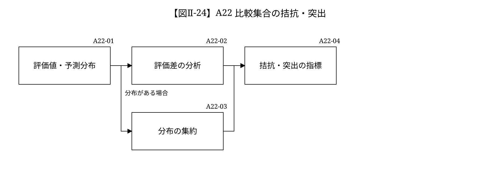

**【表Ⅱ-27】A22 構成要素と役割**

| 記号 | 構成要素 | 手法 | 役割・入出力 |
| --- | --- | --- | --- |
| A22-01 | 評価値・予測分布 | — | 対象集合の評価値と、必要に応じて整合した予測分布を受け取る。 |
| A22-02 | 評価差の分析 | M06 | 評価値の分散や上位間の差を集計する。 |
| A22-03 | 分布の集約 | M21 | 予測分布がある場合に、集中度などを集約する。 |
| A22-04 | 拮抗・突出の指標 | — | 評価の拮抗と分布の不確かさを別々の指標として返す。 |

評価値の拮抗と予測分布の不確かさは別々の指標として返します。集合全体の分布を要約する場合は、整合した確率分布を入力します。

A23 順位・組合せの予測

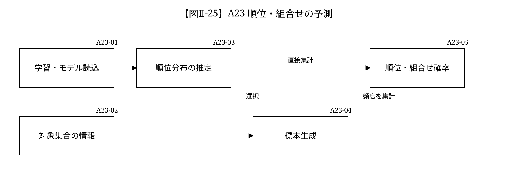

**【表Ⅱ-28】A23 構成要素と役割**

| 記号 | 構成要素 | 手法 | 役割・入出力 |
| --- | --- | --- | --- |
| A23-01 | 学習・モデル読込 | M10 | 観測順位から順位モデルを学習するか、保存したモデルを読み込む。 |
| A23-02 | 対象集合の情報 | — | 構成員、事前の特徴量、条件と組合せ制約を受け取る。 |
| A23-03 | 順位分布の推定 | M10 | 対象集合全体の制約に整合する順位分布を求める。 |
| A23-04 | 標本生成 | M20 | 近似計算を選ぶ場合、モデルから整合した順位の標本を生成する。 |
| A23-05 | 順位・組合せ確率 | — | 直接計算または標本の頻度から順位別・組合せ別の確率を返す。 |

対象数・順位の意味・同着や組合せの制約は入力定義が与えます。モンテカルロ法は確率モデルから制約を満たす標本を生成する計算であり、学習法そのものではありません。

A24 精度・信頼度・適用範囲

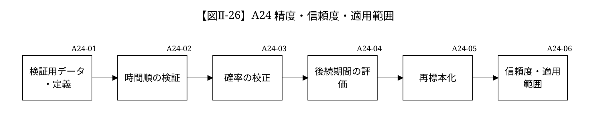

**【表Ⅱ-29】A24 構成要素と役割**

| 記号 | 構成要素 | 手法 | 役割・入出力 |
| --- | --- | --- | --- |
| A24-01 | 検証用データ・定義 | — | 検証する分析定義、時系列データ、実績値、分割・評価設定を受け取る。 |
| A24-02 | 時間順の検証 | M22 | 時間順に分割し、各窓の過去だけで前処理とモデルを学習する。 |
| A24-03 | 確率の校正 | M23 | 確率出力では独立した校正期間の予測と実績から校正器を学習する。 |
| A24-04 | 後続期間の評価 | — | 未使用の後続期間で予測し、校正後の結果も評価する。 |
| A24-05 | 再標本化 | M24 | 観測イベントや時間ブロック等の依存を保つ単位で再標本化する。 |
| A24-06 | 信頼度・適用範囲 | — | 誤差、校正、推定幅、条件別の適用範囲を返す。 |

確率校正は確率出力に適用し、数値予測等では省略します。校正用と最終評価用を分け、再標本化は観測イベントや時間ブロック等の依存を保つ単位で行います。

### 分析手法とINPUT

M01〜M24の分析手法と必要なINPUT

yは説明・予測したい値、Xはその説明に用いる項目の集合です。学習時のデータと、予測時の「学習済みモデル＋対象データ」を分けて扱います。

| 記号 | 分析手法 | データのINPUT | 定義・設定 | OUTPUT |
| --- | --- | --- | --- | --- |
| M01 | 階層的重回帰分析 | 同じ観測集合のy・X | 変数ブロックの順序、比較指標 | 段階ごとのモデル・係数・R²・増分 |
| M02 | マルチレベル回帰・混合効果モデル | y・X・グループキー | 固定効果・変動効果、入れ子／交差、推定方式 | モデル・共通効果・対象別効果・推定幅 |
| M03 | 階層ベイズモデル | 観測・説明変数・グループ構造 | 尤度・事前分布・階層構造・推定設定 | 事後分布・予測分布・推定診断 |
| M04 | 重回帰分析 | 数値y・説明変数X | 式・項・学習条件 | 回帰モデル・係数・予測値 |
| M05 | 交互作用の分析 | 変数・カテゴリ・グループの定義 | 組合せる項、交互作用、主効果 | モデル構造または設計行列の指定 |
| M06 | 分布・ばらつき・残差の分析 | 数値列・対象／条件／時点 | 集計範囲・分位点・差分、必要なら予測参照 | 分布要約・残差・差分・件数 |
| M07 | 分位点回帰 | 数値y・説明変数X | 分位点・式・推定条件 | 分位点モデル・条件付き分位点 |
| M08 | ロジスティック回帰 | カテゴリy・X・クラス定義 | 二値／多項／順序、リンク、必要な群構造 | 分類モデル・クラス別確率 |
| M09 | 判別分析 | 既知クラスラベル・数値特徴量 | LDA／QDA・共分散条件・事前確率 | 判別モデル・クラス確率・判別軸 |
| M10 | 順位モデル | 比較集合ID・構成員・観測順位・特徴量 | 順位モデル、同着／欠測の扱い、群構造 | 順位モデル・集合単位の順位分布 |
| M11 | 決定木・分類木 | y・X・型／カテゴリ定義 | 分類／回帰、木の深さ等 | 決定木モデル・予測値／確率 |
| M12 | 勾配ブースティング | y・X・対象／時点キー | 損失関数・木と学習の設定 | 学習モデル・予測値／確率 |
| M13 | 一般化加法モデル | y・X・平滑化する列 | 分布・リンク・平滑化基底／強さ | GAMモデル・関係曲線・予測値 |
| M14 | 状態空間モデル | 時刻・系列キー・観測値 | 状態／観測モデル・間隔・更新方式 | 時点別状態・予測分布・推定幅 |
| M15 | 変化点検出 | 時刻または順序・系列値 | 変化の対象・コスト・罰則等 | 変化点・区間・変化量 |
| M16 | 遷移確率の分析 | 対象・順序・前後の状態 | 状態区分・母数・対象条件 | 遷移件数・遷移確率行列 |
| M17 | 条件調整した前後比較・分割時系列回帰 | 時刻・観測値・前後境界・条件 | 比較窓・回帰式・調整方法 | 前後差・水準／傾きの変化 |
| M18 | 主成分分析 | 対象×数値特徴量の表 | 標準化・成分数・学習対象 | 変換モデル・主成分得点・寄与率 |
| M19 | クラスタリング | 特徴量表または距離行列 | 距離・群数／密度・方法 | 群ラベル・代表値・所属情報 |
| M20 | モンテカルロ法 | 確率モデル参照・条件・入力分布 | 反復数・乱数seed・集計事象 | 標本・事象確率・計算誤差 |
| M21 | 分布集約・区分判定 | 集合構成・比較可能な評価値／分布 | 集約式・重み・区分境界 | 集合の集約値・区分・根拠 |
| M22 | 時系列検証 | アルゴリズム定義・時系列データ・ラベル | 学習／校正／評価の窓・群分割・評価指標 | 各期間の予測・誤差・実行参照 |
| M23 | 確率校正 | 独立した校正用予測確率と実ラベル | 校正法・クラス定義 | 校正器・校正後確率・指標 |
| M24 | 再標本化・ブートストラップ | 観測データ・統計量または算法参照 | 再標本化単位・反復数・seed・再学習範囲 | 分布・標準誤差・区間 |

[考え方と全体の構成に戻る](README.md)

## Ⅲ 発想・分析とAIの活用｜基礎分析結果をLLMへ渡す

**Hotakaが統計・機械学習によって得た結果と、検索した関連知識をLLMの推論時にINPUTし、問いや条件に沿って解釈・比較・仮説の検討を行う構成です。**

Ⅱでは、アルゴリズムを実装した個々のスロットが、INPUTに対応する計算を実行します。その結果を204に蓄積し、Ⅲでは分析目的に合う結果を選んでLLMへ渡します。対象や指標の意味は入力定義から与え、特定テーマの名称や計算式を共通の処理へ固定しません。

この節では、301〜305の役割とデータの流れ、Ⅴからの関連知識の検索・RAG注入、HotakaによるLLMモデル・KVキャッシュ管理、llama.cppによる推論の責務を示します。

### 【図Ⅲ-1】基礎分析結果を用いたAI分析の構成

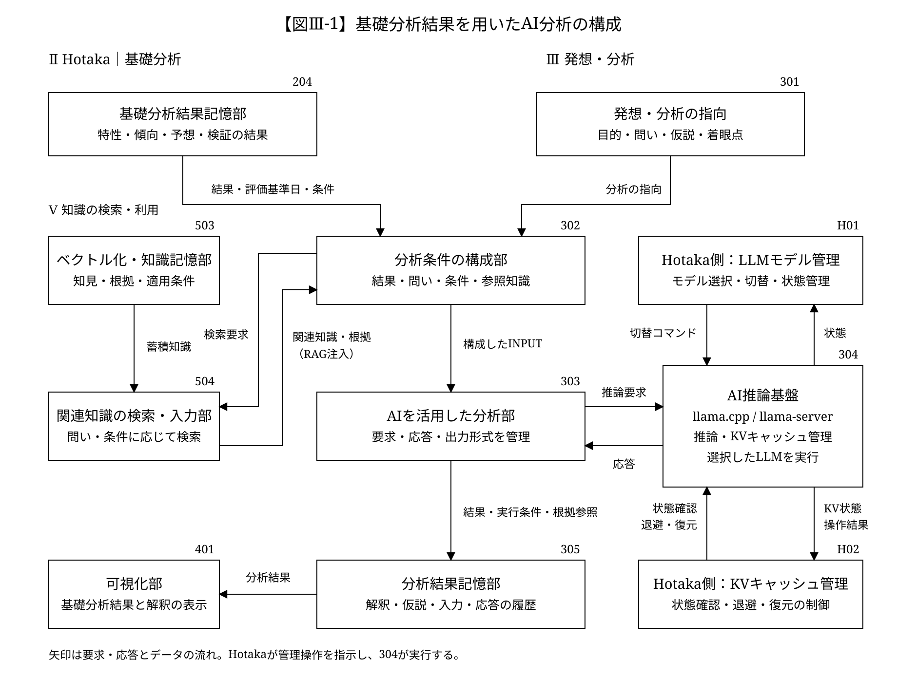

### 【表Ⅲ-1】構成要素と役割

| 記号 | 構成要素 | 役割・入出力 |
| --- | --- | --- |
| 204 | 基礎分析結果記憶部 | Hotakaの各スロットが計算した特性・傾向・予想・検証の結果を、対象・評価基準日・条件・実行GUIDと対応付けて保持する。Ⅲで扱う分析材料の供給元となる。 |
| 301 | 発想・分析の指向 | 人が持つ分析目的・問い・仮説・着眼点を定義する。何を比較し、どの関係や変化について考えるかを明らかにする。 |
| 302 | 分析条件の構成部 | 204の結果と301の問い・条件を整理し、504へ検索を要求する。返された関連知識を根拠・適用条件と共にINPUTへ加える（RAG注入）。対象・指標の意味・単位・評価基準日・検証結果・出力形式も含め、LLMへ渡す入力を構成する。 |
| 303 | AIを活用した分析部 | 構成したINPUTを304へ送り、返された応答を受け取る。分析の要求・応答・出力形式を管理し、結果の解釈、複数の観点の比較、仮説、追加確認事項を整理する。数値の根拠となる204の結果への参照を保持する。 |
| 304 | AI推論基盤 | llama.cppのllama-serverが、切替コマンドで選択したLLMを読み込み、API経由で推論を実行する。モデル読込・推論実行・KVキャッシュ管理／再利用を共通基盤の機能として扱う。モデルやコンテキスト長等は実行構成として指定する。 |
| H01 | LLMモデル管理（Hotaka側） | モデル選択・設定・稼働状態を管理し、モデル切替コマンドと連携する。Prompt Builderに置く想定だったモデル管理の責務を、Hotaka側へ集約する。 |
| H02 | KVキャッシュ管理（Hotaka側） | 304のllama.cppへ状態確認・退避・復元を指示し、KV状態と操作結果を受け取る。実行識別子、推論用スロット、モデルの版、入力・実行構成、保存ファイルを対応付ける。キャッシュ本体の管理と保存・読込は304が担う。 |
| 305 | 分析結果記憶部 | AIによる解釈・仮説と、入力・応答・参照した基礎分析結果を対応付けて蓄積する。RAGで採用した本文・参照元・版・検索条件も保持する。元の分析GUIDとLLM実行の識別子、LLMの版・入力定義の版・推論設定・実行日時を記録し、条件の異なる結果を比較できるようにする。 |
| 401 | 可視化部 | 基礎分析で得た計算結果と、AIが示した解釈・仮説を、それぞれの根拠・条件・評価基準日と共に表示する。 |
| 503 | ベクトル化・知識記憶部 | Ⅴで整理した知見を、本文・根拠・適用条件・検証状態・利用可能時点と対応付けて蓄積する。504による検索の供給元となる。 |
| 504 | 関連知識の検索・入力部 | 302から問い・対象・条件・評価基準日を受け、503から関連知識を検索する。適用条件と利用可能時点を確認し、採用候補の本文・参照元・版・根拠を302へ返す。 |

303から304へ推論要求を送り、304から303へ応答を返します。303は応答を実行条件・根拠参照と共に305へ渡します。H01はモデル切替を、H02はKVキャッシュの状態確認・退避・復元を304へ指示し、それぞれ状態と操作結果を受け取ります。301〜305はそれぞれの責務を識別する番号です。H01・H02はHotaka側の管理機能を示し、全体構成図・図Ⅲ-2と同じ記号を使います。

### RAGによる参照知識の注入

302は、301の問いと分析条件を検索要求として504へ渡します。504は503に蓄積された知識を検索し、関連する本文・参照元・版・根拠・適用条件を返します。302は採用する知識を選び、204の計算結果と問いに加えて、LLMへ渡すINPUTを構成します。この入力への追加をRAG注入として示しています。

503・504は全体構成図と同じ記号です。Ⅴの検索機能を、Ⅱの条件設定に加え、本図ではⅢの推論INPUTの構成にも利用します。過去時点の分析では、指定されたEvaluationDateに利用可能だった知識に検索対象を限定し、知識の検証状態や適用範囲も引き継ぎます。

参照知識と計算結果を根拠別に識別し、問いに必要な範囲をコンテキスト容量内で採用します。該当する知識がない場合も、その検索結果を記録します。305には入力へ採用した本文と参照情報を保存し、応答の根拠を辿れるようにします。302が参照知識をINPUTへ加え、H02は推論に用いるKVキャッシュの状態を管理します。

### 【図Ⅲ-2】304 AI推論基盤の詳細構成

**Hotakaがモデル切替とKVキャッシュの管理操作を指示し、llama.cppが推論・メモリ上のキャッシュ管理・退避・復元を実行します。**

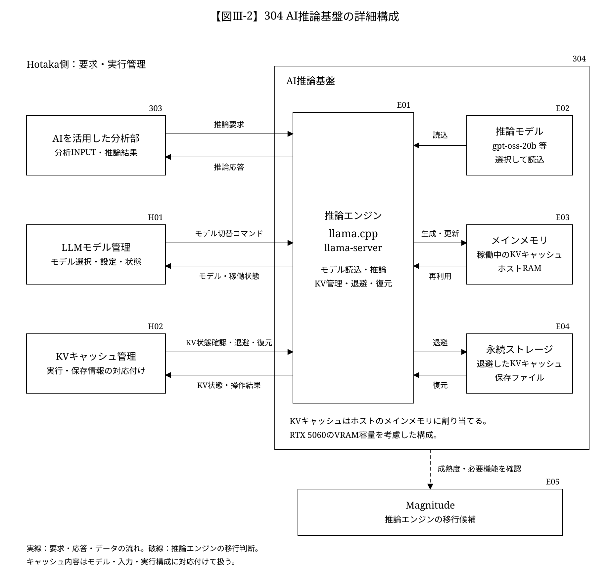

### 【表Ⅲ-2】304詳細の構成要素と役割

| 記号 | 構成要素 | 役割・入出力 |
| --- | --- | --- |
| 303 | AIを活用した分析部 | 構成した分析INPUTをE01へ送り、推論結果を受け取る。図Ⅲ-1の303と同じ役割を示す。 |
| H01 | LLMモデル管理（Hotaka側） | モデルの選択・実行設定・稼働状態を管理する。モデル切替コマンドを通じてE01が読み込むモデルを変更し、切替結果と応答可能状態を確認する。 |
| H02 | KVキャッシュ管理（Hotaka側） | E01へ状態確認・退避・復元を指示し、結果を受け取る。実行識別子、推論用スロット、モデルの版、入力・実行構成、保存ファイルを対応付ける。 |
| 304 | AI推論基盤 | 推論エンジン・推論モデル・稼働中のKVキャッシュ・退避先を組み合わせる。Hotakaからの推論要求と管理操作を受け付ける。枠は機能と資源の範囲を示す。 |
| E01 | 推論エンジン：llama.cpp／llama-server | 選択したE02を読み込んで推論する。H02の指示に従い、E03のKVキャッシュの状態を返し、E04への退避とE04からの復元を実行する。 |
| E02 | 推論モデル | モデル管理で選択するLLM。gpt-oss-20b・Swallow・Functionary等を切替対象として扱い、モデルの版と対応する実行設定を管理する。 |
| E03 | メインメモリ上のKVキャッシュ | llama.cppが管理する稼働中のキャッシュを、ホストRAMへ割り当てる。RTX 5060のVRAM容量を考慮し、KVキャッシュの配置先をメインメモリとする構成。 |
| E04 | 永続ストレージ上の退避ファイル | llama.cppがキャッシュ状態を保存・読込する領域。稼働中のE03とは保存先を分け、Hotakaが管理するモデル・入力・実行構成との対応を維持する。 |
| E05 | 推論エンジンの移行候補：Magnitude | 成熟度と、Hotakaが必要とする推論・モデル切替・メモリ配置・KVキャッシュ管理への適合を確認し、採用する推論エンジンの移行を判断する。 |

303・304・H01・H02は図Ⅲ-1と同じ記号です。E01〜E05は本図の構成要素を識別します。実線は要求・応答・データの流れ、破線は推論エンジンの移行判断を示します。

### 【表Ⅲ-3】LLMへ渡すINPUTの構成案

| 区分 | 内容 |
| --- | --- |
| 目的・問い | 比較したい条件、検討したい関係、仮説、求める説明。 |
| 計算結果 | 選択した特性・傾向・予測値・確率・分布等。利用したスロットとアルゴリズムを特定できる参照を添える。 |
| 参照知識（RAG） | 504で検索し302で採用した本文・参照元・版・根拠・適用条件・検証状態・利用可能時点。計算結果と区別してINPUTへ加える。 |
| 意味・条件 | 対象・指標の定義、単位、EvaluationDate、対象期間、比較条件、対象件数。 |
| 検証情報 | 誤差、推定幅、適用範囲、実績不足など、基礎分析から得られた情報。 |
| 応答の約束 | 計算結果と参照知識に基づく説明、仮説、追加確認事項を区別し、それぞれの根拠参照を添える。出力形式は分析目的に応じて定義する。 |

大量の結果は問いに必要な範囲を選択・分割し、コンテキスト容量に収まるINPUTを構成します。処理時の実行日時とEvaluationDateを区別し、過去時点の分析では、その時点に利用可能だった材料の範囲を保持します。

### モデル管理と切替コマンド

**LLMモデル管理の責務はHotaka側に置きます。** Prompt Builderに置く想定だったモデル管理機能をHotaka側へ集約し、モデルの選択・設定・稼働状態を管理します。モデル切替コマンドを用意し、Hotakaからそのコマンドを通じて304で使用するモデルを切り替える構成です。

モデル切替コマンドは、対象モデルの指定と現在の状態確認を扱います。Swallow・Functionary・gpt-ossは切替対象の例です。Hotakaの分析アルゴリズムを構成するM01〜M24と、本節で管理するLLMは、それぞれの役割に応じて識別します。

切替時は実行中の推論との競合を制御し、選択したモデルの起動・応答可能状態を確認してから、そのモデルを使う分析を受け付ける設計とします。結果には実際に使用したLLMと設定を記録します。

### 304の実行構成とKVキャッシュ

使用するLLMは切替可能とし、gpt-oss-20bを構成例として示します。この例では、llama.cpp／llama-serverにMXFP4形式のGGUFを読み込ませます。コンテキスト長は32,768、同時処理数は1、KVキャッシュはメインメモリ上のf16形式とする設定です。これらはモデルに対応する実行設定として保持します。

**KVキャッシュの管理・再利用は、使用するLLMに共通するllama.cpp側の機能です。** RTX 5060のVRAM容量を考慮し、この構成ではKVキャッシュをホストのメインメモリに配置します。llama.cppでは `--no-kv-offload` を用いて配置を指定します。[llama.cppの実行設定](https://github.com/ggml-org/llama.cpp/blob/master/tools/server/README.md#common-params)

退避・復元は、HotakaのH02からllama-serverへ要求します。llama-serverは `--slot-save-path` で定めた保存先へ、指定した推論用スロットのキャッシュ状態を保存し、保存ファイルから復元します。Hotakaは操作結果と保存情報の対応を管理します。[llama-serverのキャッシュ保存・復元API](https://github.com/ggml-org/llama.cpp/blob/master/tools/server/README.md)

復元対象は、モデルの版・入力・実行構成との互換性が確認できるキャッシュとします。異なるモデルへの切替では、そのモデルに対応するキャッシュを選択するか、新たに生成します。退避のための保存と、稼働中のキャッシュの消去・メモリ解放は別の操作として扱います。

Hotakaの実行スロットと、llama-serverの同時処理数・推論用スロットは、それぞれ独立した実行管理です。複数の基礎分析結果を、必要な単位でLLMの入力へ構成します。

### 推論エンジンの移行方針

[Magnitude](https://magnitude.dev/)は、ハードウェアに合わせた最適化を行うオープンソースの推論エンジンです。304で採用する推論エンジンの移行候補として扱います。

移行はMagnitudeの成熟度と、使用するモデル・実行環境への適合、モデル切替、ホストRAMへのKV配置、キャッシュの状態確認・退避・復元への対応を見て判断します。Hotaka側の分析INPUT・OUTPUTと管理責務を保ちながら、推論エンジンとの接続を置き換える方針です。移行先で使うキャッシュは、そのエンジンに対応する形式で扱います。
