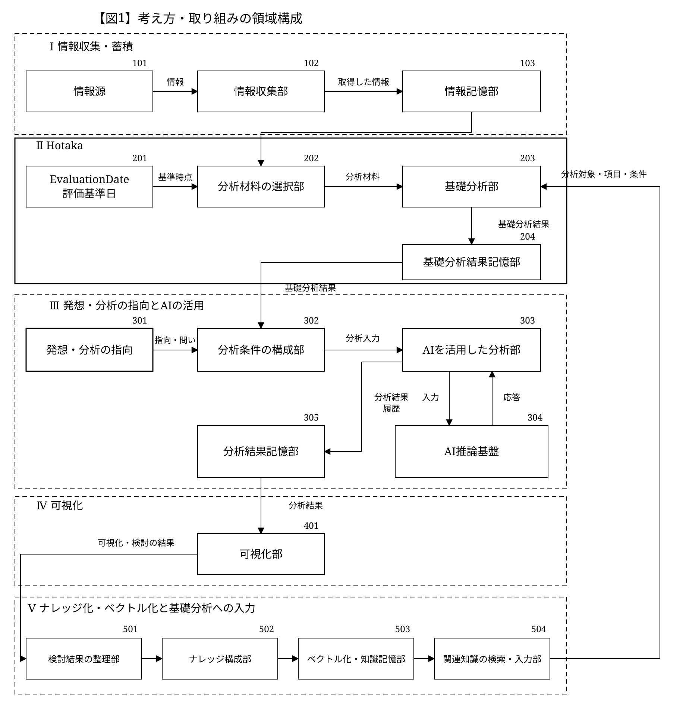

# 未来はわからない。でも、考える材料はある。

過去のデータを集めて、分析して、AIとあれこれ考えて、見える形にする。  
そこで得た気づきも、知識として蓄えて、次の分析へ。

人もAIも未来を知っているわけではないけれど、「この先どうなる？」は考え続けられる。  
そんな仕組みをつくっています。

ここでは、その考え方と全体の構成を公開しています。

## 全体の構成

## 【表1】構成要素と役割

| 番号 | 領域 | 構成要素 | 役割・考え方 |
| --- | --- | --- | --- |
| 101 | Ⅰ 情報収集・蓄積 | 情報源 | 対象分野を限定せず、分析の材料となる公式情報などを扱う。 |
| 102 | Ⅰ 情報収集・蓄積 | 情報収集部 | 定めた手順に従って情報を取得し、蓄積する。 |
| 103 | Ⅰ 情報収集・蓄積 | 情報記憶部 | 取得した情報を、過去のデータ・経験・材料として保持する。 |
| 201 | Ⅱ Hotaka | EvaluationDate | 現在または過去に設定する、分析材料の基準となる時点。 |
| 202 | Ⅱ Hotaka | 分析材料の選択部 | EvaluationDateの時点で得られる情報を分析材料として選択する。 |
| 203 | Ⅱ Hotaka | 基礎分析部 | 明示した対象・項目・条件に従い、基礎分析を行う。 |
| 204 | Ⅱ Hotaka | 基礎分析結果記憶部 | 基礎分析の結果を保持し、Ⅲの分析に渡す。 |
| 301 | Ⅲ 発想・分析 | 発想・分析の指向 | 問い・仮説・着眼点を持ち込み、何について先を考えるかを定める。本取り組みの中心となる発想を扱う。 |
| 302 | Ⅲ 発想・分析 | 分析条件の構成部 | 基礎分析の結果と指向・問いを整理し、分析入力を構成する。 |
| 303 | Ⅲ 発想・分析 | AIを活用した分析部 | 過去のデータと基礎分析結果を材料に、一定の指向で先を考える。AIを、その分析に活用する。 |
| 304 | Ⅲ 発想・分析 | AI推論基盤 | 分析の目的と前提に沿って、AIによる推論を支える。 |
| 305 | Ⅲ 発想・分析 | 分析結果記憶部 | 分析結果と入力・応答の履歴を保持する。 |
| 401 | Ⅳ 可視化 | 可視化部 | 定めた表示方法に従い、分析結果を可視化する。 |
| 501 | Ⅴ 知識化・再入力 | 検討結果の整理部 | 観察・解釈・仮説を区別し、根拠と検討経緯を記録する。 |
| 502 | Ⅴ 知識化・再入力 | ナレッジ構成部 | 知見・根拠・適用条件・検証状態・利用可能時点を整理する。 |
| 503 | Ⅴ 知識化・再入力 | ベクトル化・知識記憶部 | 知識をベクトル化し、元の記述や根拠と対応づけて蓄積する。 |
| 504 | Ⅴ 知識化・再入力 | 関連知識の検索・入力部 | 関連知識を、Ⅱの分析対象・項目・条件の設定に利用する。 |

## Ⅰ 情報収集・蓄積

### 101  情報源

| 項目 | 内容 |
| --- | --- |
| 目的 | 先を考えるための材料を、確認できる情報源から得る。 |
| 仕組み | 確認できる情報源から、時点・対象・情報の意味を明らかにして材料を得る。 対象分野に応じた情報を、分析に使える材料として扱う。 |

### 102  情報収集部

| 項目 | 内容 |
| --- | --- |
| 目的 | 材料を継続的に集め、情報の不足や変化を把握できるようにする。 |
| 仕組み | 収集した情報を出典や時点と対応づけ、その意味を保って整理する。 材料の範囲や不足を把握し、分析に必要な情報を蓄積する。 |

### 103  情報記憶部

| 項目 | 内容 |
| --- | --- |
| 目的 | 取得した事実を、繰り返し分析に使える材料として残す。 |
| 仕組み | 材料を元の情報や出典と対応づけ、後から確認できる形で保持する。 取得情報と、後続の集計・解釈を分離して管理する。 |

## Ⅱ Hotaka｜基礎分析

### 201  EvaluationDate

| 項目 | 内容 |
| --- | --- |
| 目的 | 現在でも過去でも、その時点の材料から先を考えられるようにする。 |
| 仕組み | EvaluationDateを、分析に利用できる情報を定める基準時点とする。 過去時点の再現では、その時点で利用可能だった情報を材料とする。 |

### 202  分析材料の選択部

| 項目 | 内容 |
| --- | --- |
| 目的 | 情報の条件や違いを保ち、分析対象に合った材料を用意する。 |
| 仕組み | 対象・期間・属性・利用可能時点を確認し、分析目的に応じて材料を選ぶ。 対象や状況の変化を考慮し、意味の異なる情報を混同しない。 |

### 203  基礎分析部

| 項目 | 内容 |
| --- | --- |
| 目的 | 解釈や仮説の土台となる、条件の明確な分析基礎データを作る。 |
| 仕組み | 明示した対象・項目・条件に従い、定めた分析を行う。 比較や変化の把握に使う材料を整え、解釈や仮説とは区別する。 |

### 204  基礎分析結果記憶部

| 項目 | 内容 |
| --- | --- |
| 目的 | 各時点の分析材料を残し、過去の比較とⅢへの受け渡しを可能にする。 |
| 仕組み | 基礎分析の出力を、評価基準日と分析条件に対応づけて保持する。 Ⅲで導く解釈・仮説を含む分析結果とは区別する。 |

## Ⅲ 発想・分析の指向｜問いと入力の構成

### 301  発想・分析の指向

| 項目 | 内容 |
| --- | --- |
| 目的 | 過去のデータを経験・材料として、何について先を考えるかを定める。 |
| 仕組み | 問い・仮説・着眼点を持ち込み、見る対象や関係を選ぶ。 対象の特性、組合せ、条件への適合、時間による変化などを考える。 |

### 302  分析条件の構成部

| 項目 | 内容 |
| --- | --- |
| 目的 | 発想を、AIへ渡せる明確な問いと条件にする。 |
| 仕組み | 材料・背景・判断の規則・進め方・出力形式・今回の問いを組み合わせる。 材料と問いの関係を明確にし、分析の前提を確認できるようにする。 |

### 302  入力構成の内訳

| 項目 | 内容 |
| --- | --- |
| 目的 | 共通の約束、対象固有の条件、今回の問いを分けて扱う。 |
| 仕組み | 分析の目的と共通の規則、対象に固有の条件を区別する。 背景となる材料と文脈、検討の進め方を整理する。 問いと求める結果の表現を明らかにする。 |

## Ⅲ AIの活用｜分析の実行と履歴

### 303  AIを活用した分析部

| 項目 | 内容 |
| --- | --- |
| 目的 | 材料と発想を結びつけ、その先を考える分析にAIを活用する。 |
| 仕組み | 材料・条件・問いをもとにAIで複数の見方や仮説を検討し、人の判断につなげる。 AIが未来を知っていることを前提にせず、材料から考えられる範囲を探る。 |

### 304  AI推論基盤

| 項目 | 内容 |
| --- | --- |
| 目的 | 分析の目的と前提に沿って、AIによる推論を支える。 |
| 仕組み | 材料と問いを受け取り、分析に利用できる応答を得る。 分析の指向と、その検討を支える推論の役割を分ける。 |

### 305  分析結果記憶部

| 項目 | 内容 |
| --- | --- |
| 目的 | どの材料・問いから得た応答かを振り返り、次の検討へつなげる。 |
| 仕組み | 材料・問い・条件・応答を対応づけ、検討の経緯を保持する。 Ⅲの分析結果と、Ⅱで用意した分析基礎データを区別する。 |

## Ⅳ 可視化｜検討結果を知識につなぐ

### 401  可視化部

| 項目 | 内容 |
| --- | --- |
| 目的 | 材料・基礎分析・分析結果を、人が比較して検討できる形で示す。 |
| 仕組み | 定めた表示方法で、対象・期間・評価日を区別して表示する。 元の事実、集計値、仮説を含む結果を混同しない構成とする。 |

### 401 → 501  可視化から検討結果の整理へ

| 項目 | 内容 |
| --- | --- |
| 目的 | 比較・検討した内容を、次の分析で再利用できる知識の材料にする。 |
| 仕組み | 表示結果に対する観察・解釈・仮説を、参照した分析結果とともにⅤへ渡す。 実際の結果と照合できる時点では、その差や適用条件も記録する。 |

## Ⅴ ナレッジ化・ベクトル化｜基礎分析への入力

### 501  検討結果の整理部

| 項目 | 内容 |
| --- | --- |
| 目的 | 検討から得た気づきを、根拠に戻って確認できる記録にする。 |
| 仕組み | 観察した事実・解釈・仮説を分け、対象・評価日・参照結果を記録する。 反例や未確認事項も残し、検討に至った経緯を辿れるようにする。 |

### 502  ナレッジ構成部

| 項目 | 内容 |
| --- | --- |
| 目的 | 検討結果を、条件を明示して再利用できる知識として整理する。 |
| 仕組み | 知見・根拠・適用条件・検証状態をひとまとまりにする。 知識の作成・更新時点を保持し、未検証の仮説と検証済みの知見を区別する。 |

### 503  ベクトル化・知識記憶部

| 項目 | 内容 |
| --- | --- |
| 目的 | 蓄積した知識を、意味の近い内容から検索できるようにする。 |
| 仕組み | ナレッジをベクトル化し、元の記述・根拠・適用条件と対応づけて蓄積する。 ベクトルの類似性と知見の妥当性は分けて扱う。 |

### 504 → 203  関連知識の検索・入力部

| 項目 | 内容 |
| --- | --- |
| 目的 | 関連知識を、Ⅱの分析対象・項目・条件の設定に活かす。 |
| 仕組み | 関連知識の根拠・適用条件・検証状態を確認し、分析条件として明示する。 過去時点の再現では、その時点で利用可能だった知識に限定する。 |
| 循環 | Ⅴ→Ⅱ→Ⅲ→Ⅳ→Ⅴ Ⅰ 情報収集・蓄積　　Ⅱ Hotaka：基礎分析 Ⅲ 発想・分析の指向とAIの活用　　Ⅳ 可視化 Ⅴ ナレッジ化・ベクトル化と基礎分析への入力 Ⅰの情報を土台とし、Ⅴの知識をⅡの条件設定に活かして循環する。 |

## 【表2】領域と内容｜Ⅰ・Ⅱ

| 番号 | 領域 | 内容 |
| --- | --- | --- |
| 101 | 情報源 | 先を考えるための材料を、確認できる情報源から得る。 対象分野に応じて、情報の意味と範囲を明らかにする。 |
| 102 | 情報収集 | 必要な材料を継続的に集め、情報の不足や変化を把握する。 収集した情報を出典や時点と対応づけて整理する。 |
| 103 | 情報の蓄積 | 材料を出典と対応づけ、繰り返し分析に使える形で保持する。 元の情報と、分析や解釈によって得られた結果を区別する。 |
| 201 | 評価基準日 | 分析に利用できる情報を定める基準時点を置く。 過去時点の再現では、その時点で利用可能だった材料を用いる。 |
| 202 | 分析材料の選択 | 対象・期間・属性・利用可能時点を確認し、目的に合った材料を選ぶ。 情報の条件や違いを保ち、意味の異なる材料を混同しない。 |
| 203 | 基礎分析 | 明示した対象・項目・条件に従い、解釈や仮説の土台となる分析を行う。 Ⅴの知識を条件設定に活かし、元の事実と区別して扱う。 |
| 204 | 基礎分析結果の保持 | 基礎分析の結果を、評価基準日と分析条件に対応づけて保持する。 条件間の比較とⅢへの受け渡しに使う材料とする。 |

## 【表3】領域と内容｜Ⅲ・Ⅳ・Ⅴ

| 番号 | 領域 | 内容 |
| --- | --- | --- |
| 301 | 発想・分析の指向 | 過去の材料から問いや仮説を組み立て、何について先を考えるかを定める。 観察された事実と解釈を区別し、検討する観点を明らかにする。 |
| 302 | 分析入力の構成 | 分析の目的に応じて、材料・背景・条件・問いを組み合わせる。 分析の前提と求める応答を明確にし、一貫した検討につなげる。 |
| 303 | AIを活用した分析 | 過去の材料と基礎分析の結果をもとに、一定の指向で先を考える。 AIを用いて複数の見方や仮説を検討し、結果を人の判断につなげる。 |
| 304 | AI推論基盤 | 分析の目的と前提に沿って、材料と問いから応答を得る。 AIを継続して活用するための共通環境を支える。 |
| 305 | 分析結果・履歴 | 分析の前提・入力・応答を対応づけ、検討の経緯を保持する。 条件の違いによる結果を比較し、後から振り返るための材料とする。 |
| 401 | 可視化 | 材料・基礎分析・分析結果を、人が比較して検討できる形で示す。 対象・期間・評価基準日を区別し、結果の理解を助ける。 |
| 501 | 検討結果の整理 | 可視化された結果への検討を、事実・解釈・仮説に分けて整理する。 根拠や条件と対応づけ、再利用できる知識の材料とする。 |
| 502 | ナレッジ化 | 検討結果を、根拠・適用条件・検証状態を伴う知識としてまとめる。 知識が利用可能になった時点を保持し、再利用の範囲を明らかにする。 |
| 503 | ベクトル化・知識の蓄積 | ナレッジをベクトル化し、意味の近い知識を検索できる形で蓄積する。 元の記述や根拠との対応を保ち、類似性と知見の妥当性を分けて扱う。 |
| 504 | 関連知識の入力・循環 | 関連知識の適用条件と利用可能時点を確認し、Ⅱの対象・項目・条件に反映する。 Ⅴ→Ⅱ→Ⅲ→Ⅳ→Ⅴの循環により、知識を次の分析に活かす。 |

## 実装と事例

この概念に基づく実装や事例は、公開したものから別ページで紹介していきます。

[実装と事例の公開ページへ](IMPLEMENTATIONS.md)

## 資料のダウンロード

- [図と表をまとめたSVG（全10ページ）](./concept.svg)
- [Word文書（全10ページ）](./concept.docx)
